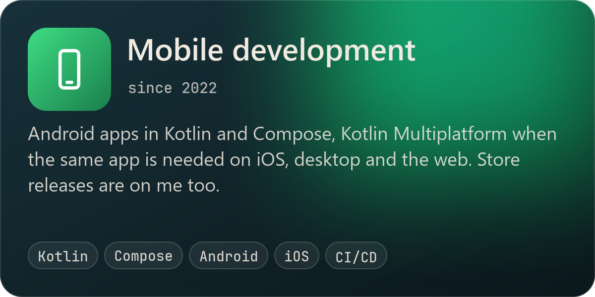
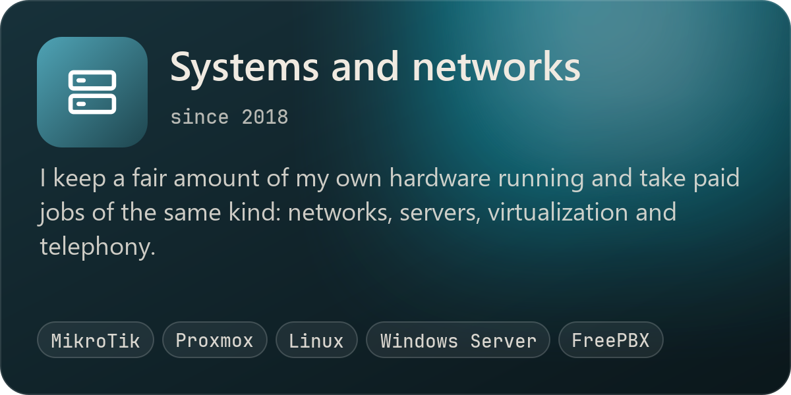
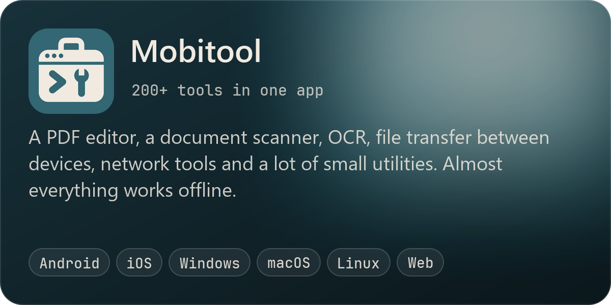
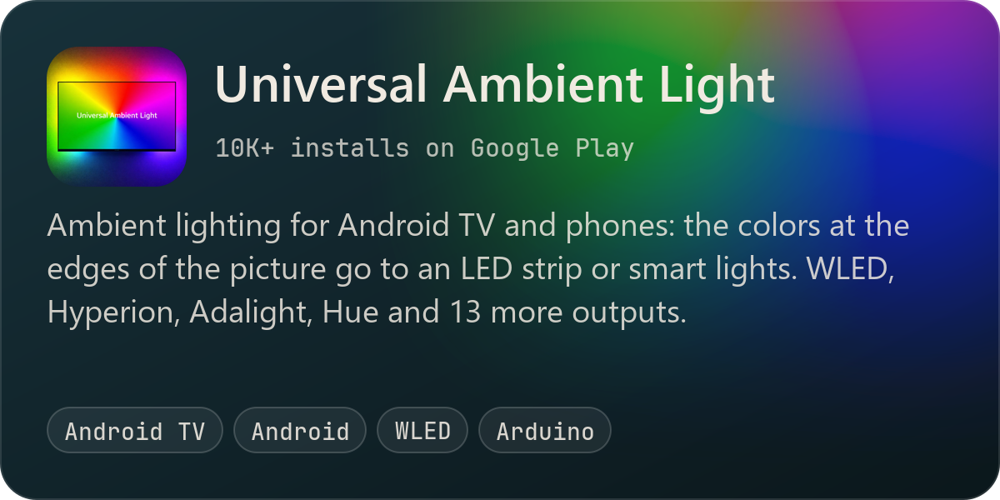
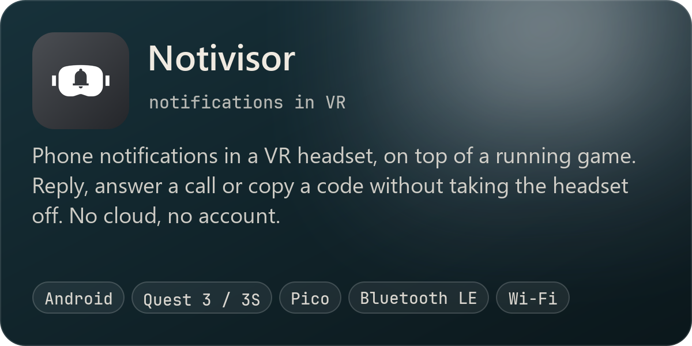
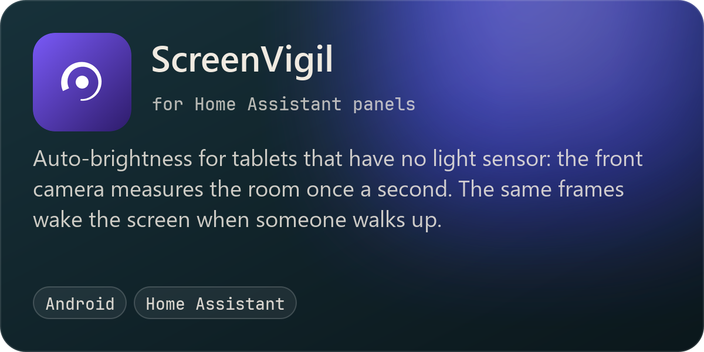
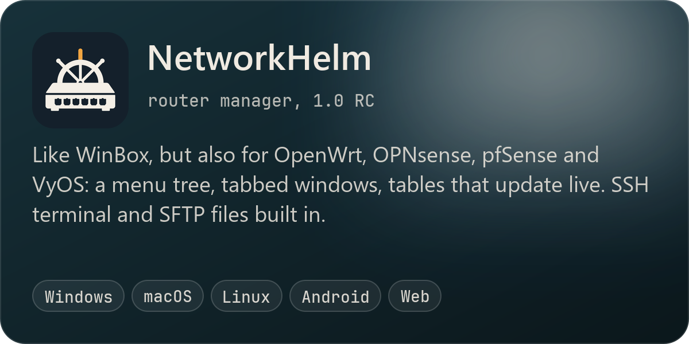
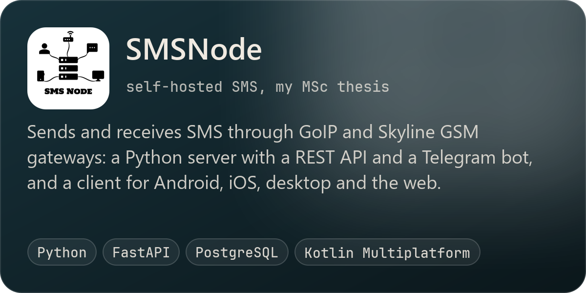
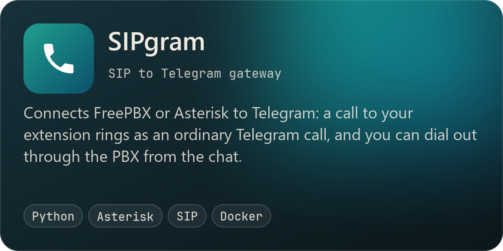
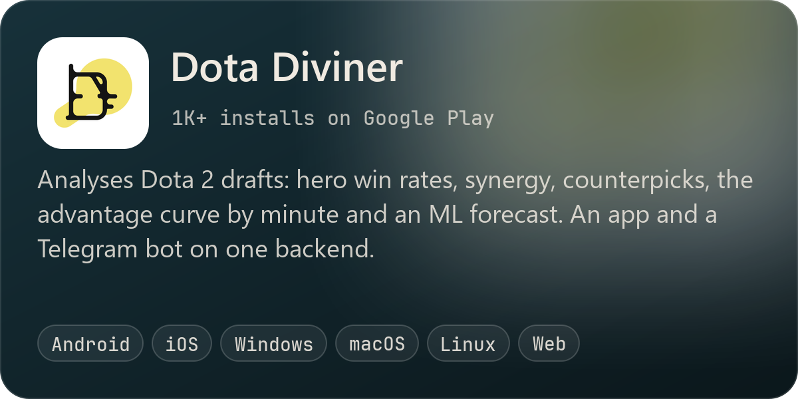

I'm Vasilii. I write Android and Kotlin Multiplatform apps and work as a systems and network engineer.
MSc in Software Engineering from NRNU MEPhI. I can join a team or build a project alone, from the first
screen to the store release.

## Projects

Where to get the apps

| App | Links |
| --- | --- |
| Mobitool | [Web](https://vasmarfas.com) · [Google Play](https://play.google.com/store/apps/details?id=com.vasmarfas.mobitool) · [App Store](https://apps.apple.com/app/id6816425850) · [Microsoft Store](https://apps.microsoft.com/detail/9MWHC2SBXFV1) · [RuStore](https://www.rustore.ru/catalog/app/com.vasmarfas.mobitool) |
| Universal Ambient Light | [Google Play](https://play.google.com/store/apps/details?id=com.vasmarfas.UniversalAmbientLight) · [RuStore](https://www.rustore.ru/catalog/app/com.vasmarfas.UniversalAmbientLight) |
| Notivisor | [Google Play](https://play.google.com/store/apps/details?id=com.vasmarfas.notivisor) · [RuStore](https://www.rustore.ru/catalog/app/com.vasmarfas.notivisor) |
| ScreenVigil | [Google Play](https://play.google.com/store/apps/details?id=com.vasmarfas.screenvigil) · [RuStore](https://www.rustore.ru/catalog/app/com.vasmarfas.screenvigil) |
| NetworkHelm | [Site](https://vasmarfas.github.io/networkhelm/) |
| SMSNode | [Google Play](https://play.google.com/store/apps/details?id=com.vasmarfas.smsnode) · [App Store](https://apps.apple.com/app/id6760977645) · [Microsoft Store](https://apps.microsoft.com/detail/9NVHGS0T2HD2) · [RuStore](https://www.rustore.ru/catalog/app/com.vasmarfas.smsnode) · [Server](https://github.com/vasmarfas/SMSNodeBackend) |
| Dota Diviner | [Site](https://dotadiviner.com) · [Google Play](https://play.google.com/store/apps/details?id=ru.vasmarfas.dotadivinerapp) · [App Store](https://apps.apple.com/app/id6741724843) · [Microsoft Store](https://apps.microsoft.com/detail/9N06XZ0QV6MT) · [RuStore](https://www.rustore.ru/catalog/app/ru.vasmarfas.dotadivinerapp) |

I write about these projects on Habr, in Russian.

